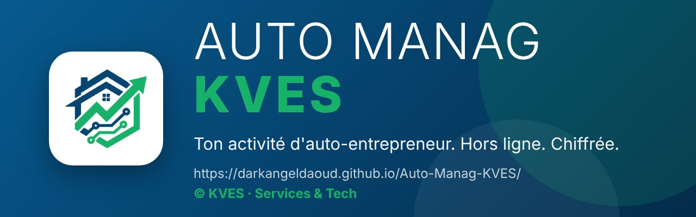
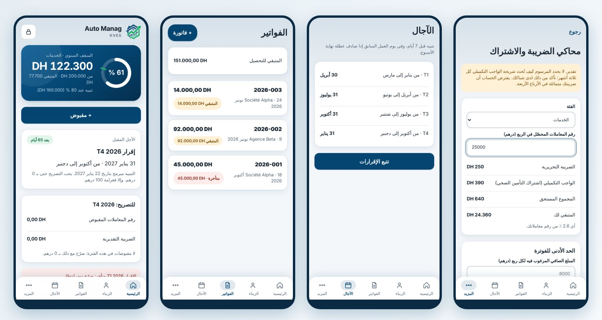

# Auto Manag KVES

مُدير الجيب للمقاول الذاتي المغربي: الزبناء، الفواتير بصيغة PDF، المقبوضات، المصاريف، الإقرارات الضريبية ومحاكي الضريبة، **بدون إنترنت**، **مشفّر** و**بدون حساب**.

الإصدار 2.0.1 · © KVES · تطبيق ويب قابل للتثبيت (PWA) · كل بياناتك تبقى في هاتفك

**لغات هذا الملف:** [Français](README.md) · [English](README.en.md) · العربية · [Darija](README.darija.md)

> **تنبيه:** هذه الترجمة العربية تحتاج إلى مراجعة من شخص متحدث بالعربية قبل نشرها للعموم.

<i>لقطات بيانات تجريبية.</i>

---

## باختصار

- **بدون إنترنت**: بعد أول فتح، يعمل كل شيء دون اتصال.
- **مشفّر**: بياناتك محمية بكلمة مرور رئيسية (AES-256) ومفتاح استرداد. لا حساب، لا إعلانات، لا تتبّع، ولا يُرسَل أي شيء.
- **مصمَّم لنظام المقاول الذاتي بالمغرب**: السقف السنوي، ضريبة 1 % أو 0,5 %، آجال الإقرارات، الواجب التكميلي، قواعد التأخير.
- **ثلاث لغات**: الفرنسية، الإنجليزية، العربية (من اليمين إلى اليسار).

## ما فائدته؟

| المشكلة | ما يفعله التطبيق |
|---|---|
| لا أعرف أين وصلت بالنسبة للسقف السنوي | مؤشر في الصفحة الرئيسية وتنبيه عند 80 % |
| أنسى آجال الإقرارات | الآجال (30 أبريل، 31 يوليوز، 31 أكتوبر، 31 يناير)، تذكيرات وتتبّع «للتصريح، مصرَّح به، مؤدّى» |
| فواتيري غير مرتبة | فواتير PDF مرقّمة تلقائيا (2026-001)، المبلغ بالحروف، البيانات القانونية، الشعار، أجل الأداء |
| لا أعرف كم سأدفع | الضريبة التقديرية لكل ربع، محاكي الضريبة والاشتراك والحد الأدنى للفوترة |
| أفقد تتبّع المقبوضات والمصاريف | مقبوضات مرتبطة بالفواتير، مصاريف حسب الفئة، النتيجة الفعلية، إلغاء مع أثر (لا شيء يُحذف خفية) |
| أخاف أن أفقد بياناتي | نسخة احتياطية مشفّرة في ملف، نسخة أمان تلقائية، فحص سلامة الخزنة |
| أريد التأكد من أن التطبيق لم يُعدَّل | توقيع رقمي يمكن التحقق منه داخل التطبيق |

**لمن؟** مقاول ذاتي مغربي يريد تدبير نشاطه بنفسه وببساطة.

**ما ليس عليه التطبيق.** أداة مساعدة على التدبير، وليست استشارة ضريبية أو قانونية، ولا تغني عن محاسب أو عن الإدارة. المبالغ والتواريخ تقريبية: تحقق منها في rn.ae.gov.ma ولدى الإدارة. انظر [القواعد القانونية](#القواعد-القانونية-ونقاط-للتأكد).

---

## تثبيت التطبيق

يتم التثبيت مرة واحدة، مع الإنترنت. عنوان التطبيق:

`https://darkangeldaoud.github.io/Auto-Manag-KVES/`

**أندرويد (Chrome)**
1. افتح العنوان في Chrome.
2. اضغط على القائمة ثم **تثبيت التطبيق** (أو **إضافة إلى الشاشة الرئيسية**).
3. افتح أيقونة Auto Manag واتركها تُحمَّل بضع ثوان.
4. جرّب في وضع الطيران: يجب أن يفتح التطبيق بشكل عادي.

**آيفون / آيباد (Safari)**
1. افتح العنوان في Safari.
2. اضغط **مشاركة** ثم **إضافة إلى الشاشة الرئيسية**.
3. افتح التطبيق من أيقونته (وليس من Safari): هذا ما يمنحه مساحة تخزين خاصة به.

**الحاسوب**: يعمل في Chrome أو Edge، وتقترح قائمة المتصفح التثبيت أيضا.

---

## استعمال التطبيق

**1. أول تشغيل (3 دقائق)**
- أنشئ **كلمة المرور الرئيسية** (12 حرفا على الأقل، ومؤشر القوة يساعدك).
- **دوّن مفتاح الاسترداد** واحفظه بعيدا عن الهاتف: هو الحل الوحيد إذا نسيت كلمة المرور.
- في **المزيد**، املأ **مقاولتي** (الاسم، ICE، العنوان) و**النشاط**. يمكنك أولا التجربة ببيانات تجريبية (المزيد > بيانات تجريبية) وحذفها بنقرة.

**2. يوميا**
- **الزبناء**: أضف زبناءك (يُنصح بإدخال ICE للفواتير).
- **الفواتير**: أنشئ فاتورة، راجع المعاينة، أصدرها وشارك ملف PDF. الفاتورة الصادرة مقفلة؛ تُلغى مع أثر ولا تُحذف.
- **المقبوضات**: عند استلام أداء، اختر **تسجيل أداء** في الفاتورة. تُحدَّث الصفحة الرئيسية بسقفك وضريبتك التقديرية.
- **المصاريف**: سجّلها لترى نتيجتك الفعلية (لا تؤثر على ضريبة المقاول الذاتي).

**3. كل ثلاثة أشهر**
- افتح **الآجال**: يذكّرك التطبيق بالتاريخ ويعرض رقم المعاملات المقبوض والضريبة التقديرية. صرّح في البوابة الرسمية، ثم اجعل الفترة **مصرَّح بها** ثم **مؤدّاة**. يتوفر ملخص PDF. حتى بدون رقم معاملات، يجب التصريح بصفر، وإلا فغرامة 100 درهم.

**4. النسخ الاحتياطي**
- **المزيد > النسخ الاحتياطي**: أنشئ ملفا مشفّرا وأرسله إلى Drive أو احتفظ به في جهاز آخر. يذكّرك التطبيق (بعد 3 ثم 7 أيام). هذا ما يحميك عند ضياع الهاتف أو إعادة ضبطه.

---

## أمانك

| الحماية | التفاصيل |
|---|---|
| التشفير | كلمة مرور رئيسية، PBKDF2 (600 000 تكرار)، AES-256-GCM |
| القفل | تلقائي بعد 5 دقائق دون نشاط؛ في الخلفية: فوري، دقيقة أو 5 دقائق (حسب اختيارك) |
| نسيان كلمة المرور | مفتاح الاسترداد؛ بدون كلمة المرور وبدون المفتاح لا يمكن استرجاع البيانات |
| المحاولات المتكررة | بعد 5 إخفاقات، تطول مدة الانتظار مع كل إخفاق جديد |
| الشبكة | لا يُرسَل أي شيء؛ لا سكريبت ولا نمط ولا اتصال خارجي (سياسة أمان صارمة) |
| التحديثات | على مرحلتين (إعلان ثم اختيارك)؛ لا تمس بياناتك ولا كلمة مرورك |

التفاصيل في [SECURITY.md](SECURITY.md) (بالفرنسية).

## بياناتك

- **كل شيء يبقى في جهازك**، في مساحة تخزين التطبيق. لا خادم.
- **مسح بيانات المتصفح يحذف كل شيء**: صدّر نسخة احتياطية قبل ذلك.
- **إعادة ضبط كل شيء** (المزيد > الأمان) تحذف البيانات نهائيا بعد التأكيد.
- **التصدير**: ملخص PDF فصلي، المقبوضات والفواتير والمصاريف بصيغة CSV، ونسخة كاملة مقروءة بصيغة JSON. الوثائق القانونية (الفواتير والملخصات والتصدير) تبقى دائما بالفرنسية.

## التحقق من الأصالة (توقيع KVES)

كل ملف منشور مسجّل ببصمته SHA-256 في `SIGNATURE-KVES.txt`، وموقّع بمفتاح خاص بـ Auto Manag (Ed25519 مثل Coach-Mass-KVES). في **المزيد > التحقق من التطبيق** ترى «التوقيع صالح» وبصمة المفتاح، ويمكنك مقارنتها بالبصمة المنشورة في ملاحظات آخر Release. أي تحديث بتوقيع غير صحيح يُرفض.

حدّ صريح: التوقيع يثبت المصدر ويكشف أي تعديل، لكنه لا يجعل الكود غير قابل للنسخ، ولا يستطيع تطبيق ويب وحده إيقاف من يسيطر على المستودع كله. لذلك المصادقة الثنائية في GitHub، ومستقبلا نسخة أندرويد (APK).

---

## القواعد القانونية ونقاط للتأكد

القواعد داخل التطبيق (المزيد > القواعد القانونية) مع مصدرها، ويمكن تعديلها إذا تغيّر القانون: القانون 114-13 (نظام المقاول الذاتي)، المدونة العامة للضرائب (المواد 73 و82 مكرر و184 و208)، المرسوم 2-21-928 (الواجب التكميلي والاشتراك الاجتماعي)، القانون 98-15.

**ما زال يحتاج تأكيدا لدى الإدارة أو محاسبك:** هل رقم ICE للزبون إجباري في الفواتير، الجمع بين فئتين من الأنشطة، كيفية اقتطاع شريحة الواجب التكميلي خلال السنة (المحاكي يعطي تقديرا)، القرار الذي يحدد زيادة 1 % شهريا، والمبالغ الدقيقة للاشتراك. ترجمتا الإنجليزية والعربية تحتاجان إلى مراجعة قبل النشر العام (المزيد > مراجعة الترجمات يصدّر ملف CSV).

---

## للمطوّرين

تطبيق ويب ثابت: HTML وCSS وJavaScript، دون مكتبات ودون أداة بناء. الجدول التفصيلي للملفات في [README.md](README.md) (بالفرنسية) و[ARCHITECTURE.md](ARCHITECTURE.md).

الاختبارات: `cd tests && npm ci && npx playwright install chromium && node run.js` (يشغّلها GitHub أيضا عند كل إرسال). لا تضع أبدا مفتاحا خاصا أو نسخة احتياطية أو مفتاح استرداد في هذا المستودع العمومي.

## تاريخ الإصدارات

| الإصدار | الجديد |
|---|---|
| 2.0 | توقيع KVES الرقمي (Ed25519) يمكن التحقق منه في التطبيق، ورفض التحديثات ذات التوقيع الخاطئ |
| 1.8 | مظهر عصري ومريح، أمان معزَّز، مراجعة الترجمات |
| 1.7 | الامتثال: قواعد التأخير، الواجب التكميلي، الاشتراك الاجتماعي، المحاكي، سلامة الخزنة، تنبيهات الشطب، التصريح الشهري أو الفصلي |
| 1.6 | فواتير PDF بالشعار، نسخة احتياطية قابلة للتحقق |
| 1.5 | الفرنسية والإنجليزية والعربية؛ إعادة الضبط؛ القفل في الخلفية؛ تذكير النسخ الاحتياطي |
| 1.4 | فواتير مكتملة: معاينة، المبلغ بالحروف، أجل الأداء، ICE؛ كلمة مرور أقوى |
| 1.3 | الإقرارات (للتصريح، مصرَّح به، مؤدّى)، ملخص PDF، التصدير |
| 1.2 | المصاريف والنتيجة الفعلية |
| 1.1 | فواتير مرقّمة، بيانات المقاولة، مقبوض مرتبط |
| 1.0 | خزنة مشفّرة، زبناء، أنشطة، مقبوضات، ضريبة لكل ربع، آجال، نسخ احتياطي |

## خارطة الطريق

- نسخة أندرويد (APK) لحماية أقوى للتطبيق.
- مراجعة الترجمات من طرف متحدثين أصليين.
- تأكيد النقاط القانونية المذكورة أعلاه.

---

© KVES · Services & Tech

