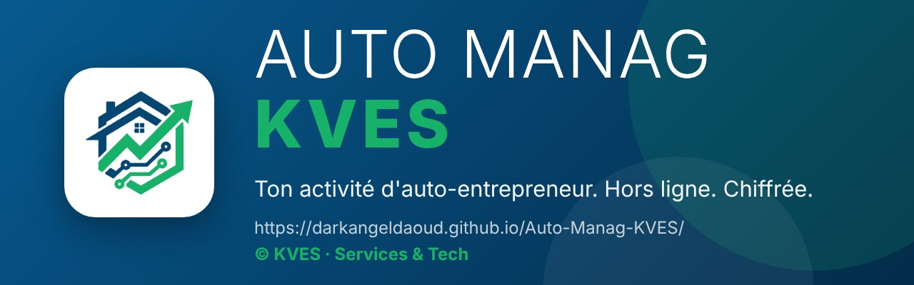
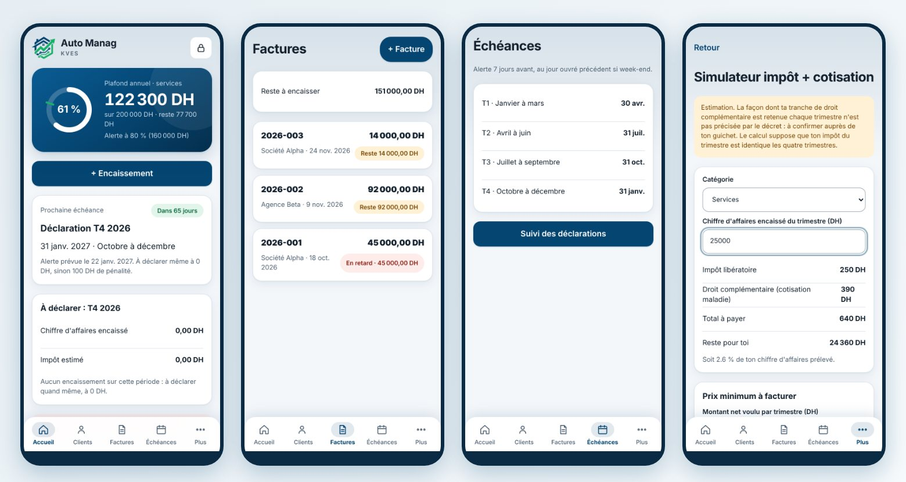

# Auto Manag KVES

L-application dyal jib l-moqawil dhati (auto-entrepreneur) f l-Maghrib: l-clients, l-factures PDF, l-flous li dkhlo, l-masarif, d-déclarations w simulateur dyal l-impôt. **Bla internet**, **mchaffra** w **bla compte**.

Version 2.1.0 · © KVES · Application web li kat t-installa (PWA) · Kol l-données dyalek kat-bqa f telephone dyalek

**Lghat dyal had l-README:** [Français](README.md) · [English](README.en.md) · [العربية](README.ar.md) · Darija

> **Tanbih:** had t-tarjama l-darija (b l-harf latini) khassha t-t9ra men chi wahed li kay-hdar darija mzyan 9bel ma tn-chr l-l-3amm.

<i>Captures b données dyal tjriba. L-application nit-ha kayna b l-français, English w l-3arbia (mashi b d-darija); l-écrans li kayn hna b l-français.</i>

---

## Bl-ikhtissar

- **Bla internet**: men be3d l-ftiha l-oula, kolchi kaykhdem bla connexion.
- **Mchaffra**: l-données dyalek m7miyin b mot de passe principal (AES-256) w clé de récupération. Bla compte, bla pub, bla suivi, w walou ma-kayt-sift.
- **M9ad l-système dyal l-moqawil dhati f l-Maghrib**: plafond sanawi, impôt 1 % wla 0,5 %, l-mawa3id dyal d-déclarations, droit complémentaire, qawa3id dyal t-ta2khir.
- **Tlata dyal l-lghat**: français, English, العربية (men limin l-lissar).

## 3la 9bel ach kat-khdem

| L-mochkil | Ach kat-dir l-application |
|---|---|
| Ma-3rfch fin wsalt men l-plafond sanawi | Jauge f s-safha r-ra2isiya w tanbih f 80 % |
| Kan-nsa l-mawa3id dyal d-déclarations | Mawa3id (30 avril, 31 juillet, 31 octobre, 31 janvier), tadkirat w suivi « à déclarer, déclaré, payé » |
| L-factures dyali ma-mrtbinch | Factures PDF m-raqmin b-l-automatique (2026-001), l-montant b l-7oruf, l-mentions légales, logo, mi3ad d-dfi3 |
| Ma-3rfch 9ed-ach ghadi nkhlless | Impôt estimé l-kol trimestre, simulateur impôt + cotisation w l-prix minimum li khass tfaktrer |
| Kan-dayya3 t-tatabbo3 dyal l-flous li dkhlo w l-masarif | Encaissements mrtabtin b l-factures, masarif 7asab l-catégorie, résultat réel, annulation b athar (walou ma-kay-tms7 b-khfya) |
| Kan-khaf n-dayya3 l-données dyali | Sauvegarde mchaffra f fichier, copie de secours automatique, fa7s dyal s-salama dyal l-coffre |
| Bghit n-t2akkad belli l-application ma-t-bddlatch | Signature numérique kat-t-t7a9a9 mn dakhel l-application |

**L-chkoun?** Moqawil dhati maghribi bgha y-dabbar chghlo b-rasso w b-bssata.

**Ach ma-hiyach had l-application.** Hiya wasila bach t3awnek f t-tadbir, mashi nasi7a diribiya wla qanouniya, w ma-katwellich blasst moHasib wla l-idara. L-mablagh w t-tawarikh ta9ribiyin: t2akkad menhom f rn.ae.gov.ma w 3and l-idara. Chouf [Qawa3id qanouniya](#qawa3id-qanouniya-w-nqat-bach-tt2akkad).

---

## Kifach t-installi l-application

T-installa merra wa7da, m3a internet. L-3onwan dyal l-application:

`https://darkangeldaoud.github.io/Auto-Manag-KVES/`

**Android (Chrome)**
1. Fte7 l-3onwan f Chrome.
2. Dghet 3la l-menu, men be3d **Installer l-application** (wla **Ajouter à l'écran d'accueil**).
3. Fte7 l-icône dyal Auto Manag w khelliha t-t7ammel chwiya dyal t-tawani.
4. Jerreb f mode avion: khassha t-t-fta7 3adi.

**iPhone / iPad (Safari)**
1. Fte7 l-3onwan f Safari.
2. Dghet 3la **Partager**, men be3d **Sur l'écran d'accueil**.
3. Fte7 l-application men l-icône (mashi men Safari): hada houa li kay3tiha l-stockage dyalha.

**Ordinateur**: kat-khdem f Chrome wla Edge, w l-menu dyal l-navigateur kay-qtere7 t-installation.

---

## Kifach tkhdem biha

**1. L-ftiha l-oula (3 d9ayeq)**
- Dir **mot de passe principal** (12 7rf 3la l-a9al, w mo2achir dyal l-9owwa kay3awnek).
- **Kteb clé de récupération** w khelliha b3ida 3la telephone: hiya l-7all l-wa7id ila nsiti mot de passe.
- F **Plus**, 3emmer **Mon entreprise** (smia, ICE, l-3onwan) w **l-activité** dyalek. Imkn lik t-jerreb 9bel b **données d'exemple** (Plus > Données d'exemple) w tms7ha b dghta wa7da.

**2. Kol nhar**
- **Clients**: zid l-clients dyalek (ICE mnasb l-l-factures).
- **Factures**: dir facture, chouf l-aperçu, sdarha, w partagi l-PDF. L-facture li tsedret kat-tsedd; kat-t-lgha b athar, ma-kat-tms7ch.
- **Encaissements**: melli kay-wsel dfi3, dghet 3la **Encaisser un paiement** f l-facture. S-safha r-ra2isiya kat-bddel l-plafond w l-impôt estimé dyalek.
- **Masarif**: sejjelhom bach t-chouf l-résultat réel dyalek (ma-kay2atter-ch 3la l-impôt dyal l-moqawil dhati).

**3. Kol 3 chhor**
- Fte7 **Échéances**: l-application kat-dekkrek b t-tarikh w kat-werrik l-chiffre d'affaires li dkhel w l-impôt estimé. Sarreh f l-portail rasmi, men be3d dir t-trimestre **déclaré**, men be3d **payé**. Kayn récapitulatif PDF. Hta ila ma-kan chi chiffre d'affaires, khassk dir déclaration b 0, ila la 3a9ouba dyal 100 DH.

**4. Sauvegarde**
- **Plus > Sauvegarde**: sawb fichier mchaffar w sifto l-Drive wla khelli-h f appareil akhor. L-application kat-dekkrek (men be3d 3 w 7 iyyam). Hiya l-7imaya dyalek ila ddaya3 telephone wla t-3awd 3ndo l-réinitialisation.

---

## Salamtek

| L-7imaya | T-tafasil |
|---|---|
| T-tachfir | Mot de passe principal, PBKDF2 (600 000 itérations), AES-256-GCM |
| L-9ofl | Automatique men be3d 5 d9ayeq bla nachat; f l-arrière-plan: f l-7in, 1 min wla 5 min (7sab l-ikhtiyar dyalek) |
| Nsiti mot de passe | Clé de récupération; bla mot de passe w bla clé, l-données ma-katt-rj3ch |
| Mo7awalat mkarrara | Men be3d 5 dyal l-fchal, l-mouda kat-tzid m3a kol fchal jdid |
| Réseau | Walou ma-kayt-sift; bla script, bla style, bla connexion khariji (politique de sécurité sarima) |
| Mises à jour | F merhalatayn (i3lan, men be3d kat-khtar nta); ma-kat-tmess la l-données la mot de passe |

T-tafasil f [SECURITY.md](SECURITY.md) (b l-français).

## L-données dyalek

- **Kolchi kay-bqa f appareil dyalek**, f l-espace de stockage dyal l-application. Bla serveur.
- **Ila msa7ti l-données dyal l-navigateur, kolchi kay-tms7**: dir sauvegarde 9bel.
- **Réinitialiser tout** (Plus > Sécurité) kat-ms7 l-données l-nihaya2iyan men be3d t-ta2kid.
- **Exports**: récapitulatif trimestriel PDF, encaissements, factures w masarif b CSV, sauvegarde kamla m9rouwa b JSON. L-wata2i9 l-qanouniya (factures, récapitulatifs, exports) dima kat-bqa b l-français.

## T-t7a9o9 men l-asala (signature KVES)

Kol fichier mon-char 3ndo l-empreinte SHA-256 dyalo f `SIGNATURE-KVES.txt`, w mowa99a3 b clé privée khassa b Auto Manag (Ed25519, bhal Coach-Mass-KVES). F **Plus > Vérifier l'application** kat-chouf « Signature valide » w l-empreinte dyal l-clé, w t9der t-9arenha m3a li kayna f notes dyal akhir Release. Ay mise à jour b signature ghalta kat-t-rfed.

7add sarih: s-signature kat-tbbet l-masdar w kat-kchef ay t-t3dil, walakin ma-kat-khelli-ch l-code ma-ytnskhch, w application web wa7dha ma-t9derch t-wqqef chi wa7ed li kayt-7akkem f l-dépôt kolo. 3la hadchi 2FA dyal GitHub, w men be3d version Android (APK).

---

## Qawa3id qanouniya w nqat bach tt2akkad

L-qawa3id kaynin f l-application (Plus > Règles légales) m3a l-masdar dyalhom, w t9der t-bddlhom ila t-bddel l-9anoun: loi 114-13 (statut dyal l-moqawil dhati), Code général des impôts (art. 73, 82 bis, 184, 208), décret 2-21-928 (droit complémentaire w cotisation sociale), loi 98-15.

**Mazal khassk t-t2akkad menhom 3and l-guichet wla l-comptable:** wach ICE dyal l-client ijbari f l-factures, jam3 jouj dyal l-catégories dyal l-activité, kifach kat-t-qta3 tranche dyal droit complémentaire f 3am (s-simulateur kay3ti ta9dir), l-arrêté li kay-7added 1 % f ch-chhar, w l-mabalegh d-da9i9a dyal l-cotisation. T-tarjamat l-englizia w l-3arabia khasshom murajaa 9bel n-nachr l-l-3amm (Plus > Relecture des traductions kay-sdder CSV).

---

## L-l-mtawwrin

Application web statique: HTML, CSS w JavaScript, bla bibliothèque w bla outil de compilation. L-jadwal dyal l-fichiers f [README.md](README.md) (b l-français) w [ARCHITECTURE.md](ARCHITECTURE.md).

L-tests: `cd tests && npm ci && npx playwright install chromium && node run.js` (GitHub kay-chghelhom f kol envoi). Ma-tdir 7atta mra clé privée, sauvegarde wla clé de récupération f had d-dépôt public.

## Tarikh dyal l-versions

| Version | Ach jab |
|---|---|
| 2.0 | Signature numérique KVES (Ed25519) kat-t-t7a9a9 f l-application, w l-mises à jour b signature ghalta kat-t-rfed |
| 1.8 | Chakl 3asri w mrih, sécurité aqwa, murajaa dyal t-tarjamat |
| 1.7 | Conformité: qawa3id dyal t-ta2khir, droit complémentaire, cotisation sociale, simulateur, salama dyal l-coffre, tanbihat dyal radiation, déclaration chahriya wla trimestrielle |
| 1.6 | Factures PDF b logo, sauvegarde kat-t-t7a9a9 |
| 1.5 | Français, English, العربية; réinitialisation; 9ofl f l-arrière-plan; tadkirat dyal sauvegarde |
| 1.4 | Factures kamlin: aperçu, montant b l-7oruf, mi3ad d-dfi3, ICE; mot de passe a9wa |
| 1.3 | Déclarations (à déclarer, déclaré, payé), récapitulatif PDF, exports |
| 1.2 | Masarif w résultat réel |
| 1.1 | Factures m-raqmin, mo3tayat l-entreprise, encaissement mrtabit |
| 1.0 | Coffre mchaffar, clients, activités, encaissements, impôt l-kol trimestre, mawa3id, sauvegarde |

## Khoutat t-triq

- Version Android (APK) l-7imaya a9wa dyal l-application.
- Murajaa dyal t-tarjamat men tara2 nas lughatohom l-oula.
- Ta2kid n-nqat l-qanouniya li t-dekret lfo9.

---

© KVES · Services & Tech
