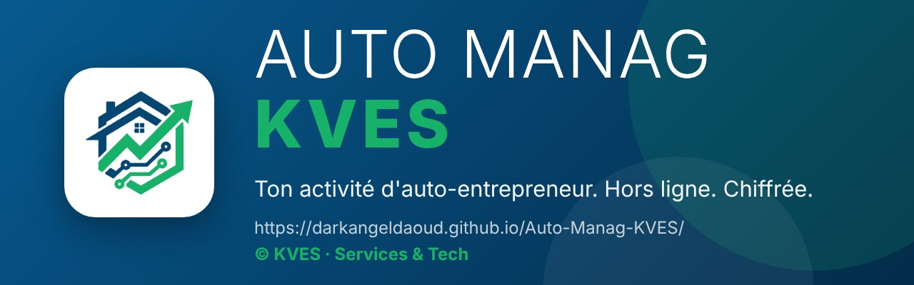
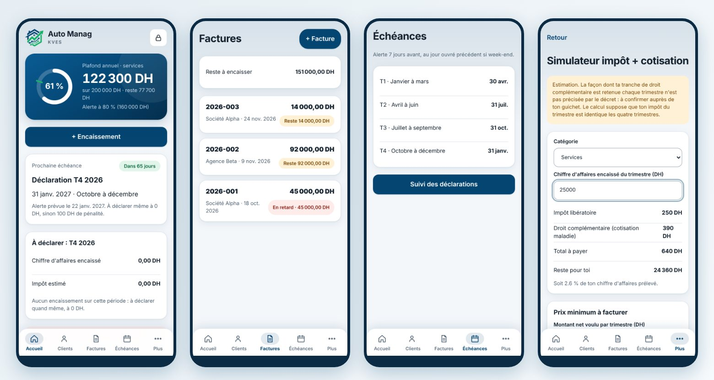

# Auto Manag KVES

The pocket manager for Moroccan auto-entrepreneurs: clients, PDF invoices, receipts, expenses, tax declarations and a tax simulator, **offline**, **encrypted** and **with no account**.

Version 2.1.1 · © KVES · Installable web app (PWA) · All your data stays on your phone

**README languages:** [Français](README.md) · English · [العربية](README.ar.md) · [Darija](README.darija.md)

<i>Screenshots taken with sample data. The app itself is in French, English and Arabic; the screens shown are in French.</i>

---

## In short

- **Offline**: after the first opening, everything works without internet.
- **Encrypted**: your data is protected by a master password (AES-256) and a recovery key. No account, no ads, no tracking, no data sent anywhere.
- **Built for the Moroccan auto-entrepreneur regime**: annual ceiling, 1 % or 0.5 % tax, declaration deadlines, complementary right, late-payment rules.
- **Three languages**: French, English, العربية (right-to-left).

## What it is for

| The problem | What the app does |
|---|---|
| I don't know where I stand against the annual ceiling | A gauge on the home screen and an alert at 80 % |
| I forget my declaration deadlines | Deadlines (30 April, 31 July, 31 October, 31 January), reminders and a "to declare, declared, paid" tracker |
| My invoices don't look professional | PDF invoices numbered automatically (YYYY-001), total in words, legal mentions, logo, payment due date |
| I don't know how much I will owe | Estimated tax per quarter, a tax + contribution simulator and a minimum price to charge |
| I lose track of receipts and expenses | Receipts linked to invoices, expenses by category, real result, traced cancellation (nothing is silently deleted) |
| I'm afraid of losing my data | Encrypted file backup, automatic safety copy, vault health check |
| I want to be sure the app has not been tampered with | Digital signature you can check inside the app |

**Who is it for?** A Moroccan auto-entrepreneur (services, and trade according to the app's rules) who wants to keep their own books, simply.

**What the app is not.** A management aid, not tax or legal advice, and not a replacement for an accountant or the administration. Amounts and dates are indicative: check them on rn.ae.gov.ma and with the administration. See [Legal rules](#legal-rules-and-points-to-check).

---

## Install the app

Installation is done once, with internet. The app address:

`https://darkangeldaoud.github.io/Auto-Manag-KVES/`

**Android (Chrome)**
1. Open the address in Chrome.
2. Tap the menu, then **Install app** (or **Add to Home screen**).
3. Open the Auto Manag icon and let it load for a few seconds.
4. Test in airplane mode: the app must open normally.

**iPhone / iPad (Safari)**
1. Open the address in Safari.
2. Tap **Share**, then **Add to Home Screen**.
3. Open the app from its icon (not from Safari): this is what gives it its own storage.

**Computer**: works in Chrome or Edge; the browser menu also offers installation.

---

## Use the app

**1. First launch (3 minutes)**
- Create your **master password** (12 characters minimum, a strength indicator helps you).
- **Write down your recovery key** and keep it away from the phone: it is the only way back if you forget the password.
- In **More**, fill in **My business** (name, ICE, address) and your **activity**. You can first try the **sample data** (More > Sample data), which can be erased in one tap.

**2. Day to day**
- **Clients**: add your clients (ICE recommended for invoices).
- **Invoices**: create an invoice, check the preview, issue it, share the PDF. An issued invoice is locked; you cancel it with a trace, you do not delete it.
- **Receipts**: when a payment arrives, tap **Collect** on the invoice. The home screen updates your ceiling and your estimated tax.
- **Expenses**: record them to see your real result (this does not change the auto-entrepreneur tax).

**3. Every quarter**
- Open **Deadlines**: the app reminds you of the date and shows the revenue received and the estimated tax. Declare on the official portal, then mark the quarter **declared**, then **paid**. A PDF summary is available. Even with no revenue, the zero declaration must still be filed (otherwise a 100 DH penalty).

**4. Back up**
- **More > Backup**: create an encrypted file and send it to your Drive or keep it on another device. The app reminds you (after 3, then 7 days). It is your protection against a lost or reset phone.

---

## Your security

| Protection | Detail |
|---|---|
| Encryption | Master password, PBKDF2 (600,000 iterations), AES-256-GCM |
| Locking | Automatic after 5 minutes of inactivity; in the background: immediately, 1 min or 5 min (your choice) |
| Forgotten password | Recovery key; without password or key, the data cannot be recovered |
| Repeated attempts | After 5 failures, a waiting delay grows with each new failure |
| Network | No data sent; no external script, style or connection (strict content security policy) |
| Updates | In two steps (announcement, then you choose); they never touch your data or your password |

Details in [SECURITY.md](SECURITY.md) (French).

## Your data

- **Everything stays on your device**, in the app's storage. No server.
- **Clearing the browser's data erases everything**: export a backup first.
- **Reset everything** (More > Security) permanently erases the data, after confirmation.
- **Exports**: quarterly PDF summary, receipts, invoices and expenses as CSV, full readable backup as JSON. Legal documents (invoices, summaries, exports) always stay in French.

## Check authenticity (KVES signature)

Every published file is listed with its SHA-256 fingerprint in `SIGNATURE-KVES.txt`, signed with a private key specific to Auto Manag (Ed25519, like Coach-Mass-KVES). In **More > Verify the application** you see "Valid signature" and the key fingerprint, which you can compare with the one in the notes of the latest Release. An update with a bad signature is refused.

Honest limit: the signature proves origin and detects any modification; it does not make the code uncopyable, and a web app cannot, on its own, stop someone who controls the whole repository. Hence GitHub two-factor authentication and, later, an Android version (APK).

---

## Legal rules and points to check

The rules are inside the app (More > Legal rules) with their source, and can be edited if the law changes: law 114-13 (auto-entrepreneur status), General Tax Code (art. 73, 82 bis, 184, 208), decree 2-21-928 (complementary right and social contribution), law 98-15.

**Still to confirm with your tax office or accountant:** whether the client's ICE is mandatory on invoices, combining two activity categories, how the complementary-right bracket is withheld during the year (the simulator gives an estimate), the order setting the 1 % monthly increase, and the exact contribution amounts. The English and Arabic translations should be reviewed before public release (More > Translation review exports a CSV).

---

## For developers

Static web app: HTML, CSS and JavaScript, with no library and no build tool.

| File | Role |
|---|---|
| `index.html` | Single page and navigation bar |
| `app-noyau.js`, `app-vues.js`, `app-factures.js`, `app-declarations.js`, `app-depenses.js`, `app-encaissements.js`, `app-reglages.js`, `app-maj.js` | Logic, by domain |
| `securite.js` | Encryption and vault |
| `donnees.js` | Version and legal rules (with sources) |
| `langues.js`, `lang-en.js`, `lang-ar.js` | Texts in French (reference), English, Arabic |
| `pdf.js` | PDF invoices and summaries |
| `signature.js`, `kves-automanag-cle-publique.txt`, `SIGNATURE-KVES.txt`, `SIGNATURE-KVES.sig` | Signature verification |
| `sw.js`, `manifest.webmanifest`, `icon-*.png` | Offline operation and installation |
| `outils/` | Signature check (`verifier.js`), fingerprint list (`manifeste.js`) |
| `tests/` | Automated tests (Playwright) |
| `docs/` | Images for this README |

See [ARCHITECTURE.md](ARCHITECTURE.md) for details. Tests: `cd tests && npm ci && npx playwright install chromium && node run.js` (also run by GitHub on every push).

**Publish or update with GitHub Pages.** In the repository, *Add file > Upload files*, then *Settings > Pages*, branch `main`, folder `/ (root)`. For each version: update the number (`donnees.js`, `sw.js`, `version.json`, `index.html`), sign, then upload all files. Never put a private key, a backup or a recovery key in this public repository.

## Version history

| Version | What it brought |
|---|---|
| 2.0 | KVES digital signature (Ed25519) checkable in the app, badly signed updates refused |
| 1.8 | Modern, airy look, stronger security (strict policy, delay after failures), translation review |
| 1.7 | Compliance: late-payment rules (tax code), complementary right, social contribution, simulator, vault health, deregistration alerts, monthly or quarterly declaration |
| 1.6 | PDF invoices with logo, verifiable backup |
| 1.5 | French, English, Arabic; reset; background locking; backup reminders |
| 1.4 | Completed invoices: preview, total in words, due date, ICE; stronger password |
| 1.3 | Declarations (to declare, declared, paid), PDF summary, exports |
| 1.2 | Expenses and real result |
| 1.1 | Numbered invoices, business details, linked receipt |
| 1.0 | Encrypted vault, clients, activities, receipts, tax per quarter, deadlines, backup |

Full history: [MISE-A-JOUR.txt](MISE-A-JOUR.txt) (French).

## Roadmap

- Android version (APK) for stronger protection of the app.
- Review by native speakers of the app translations (Arabic, English) and of the Arabic and Moroccan Darija READMEs.
- Confirmation of the legal points listed above.

---

© KVES · Services & Tech
