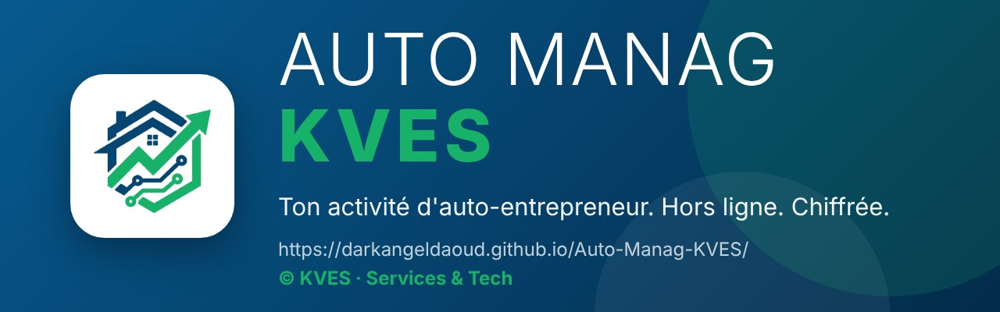
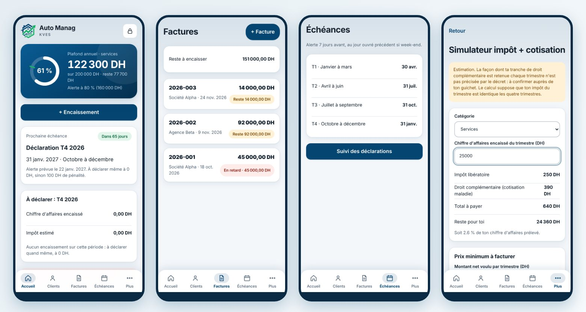

# Auto Manag KVES

Le gestionnaire de poche de l'auto-entrepreneur marocain : clients, factures PDF, encaissements, dépenses, déclarations et simulateur d'impôt, **hors ligne**, **chiffré** et **sans compte**.

Version 2.0.1 · © KVES · Application web installable (PWA) · Toutes tes données restent sur ton téléphone

**Langues du README :** Français · [English](README.en.md)

<i>Captures réalisées avec des données de démonstration.</i>

---

## En bref

- **Hors ligne** : après la première ouverture, tout fonctionne sans internet.
- **Chiffré** : tes données sont protégées par un mot de passe maître (AES-256) et une clé de récupération. Aucun compte, aucune publicité, aucun suivi, aucun envoi de données.
- **Pensé pour le régime auto-entrepreneur marocain** : plafond annuel, impôt de 1 % ou 0,5 %, échéances des déclarations, droit complémentaire, règles de retard.
- **Trois langues** : français, English, العربية (écriture de droite à gauche).

## À quoi ça sert

| Le problème | Ce que fait l'application |
|---|---|
| Je ne sais pas où j'en suis du plafond annuel | Une jauge sur l'accueil et une alerte à 80 % |
| J'oublie mes échéances de déclaration | Échéances (30 avril, 31 juillet, 31 octobre, 31 janvier), rappels et suivi « à déclarer, déclaré, payé » |
| Mes factures ne sont pas propres | Factures PDF numérotées automatiquement (AAAA-001), total en lettres, mentions légales, logo, échéance de paiement |
| Je ne sais pas combien je dois payer | Impôt estimé par trimestre, simulateur impôt + cotisation et prix minimum à facturer |
| Je perds la trace de mes encaissements et dépenses | Encaissements liés aux factures, dépenses par catégorie, résultat réel, annulation tracée (rien n'est supprimé en cachette) |
| Je crains de perdre mes données | Sauvegarde chiffrée en fichier, copie de secours automatique, contrôle de santé du coffre |
| Je veux être sûr que l'application n'a pas été modifiée | Signature numérique vérifiable dans l'application |

**Pour qui ?** Un auto-entrepreneur marocain (services, et commerce selon les règles de l'application) qui veut tenir sa gestion lui-même, simplement.

**Ce que l'application n'est pas.** Un outil d'aide à la gestion, pas un conseil fiscal ou juridique, et pas un remplacement d'un comptable ni de l'administration. Les montants et les dates sont indicatifs : vérifie-les sur rn.ae.gov.ma et auprès de l'administration. Voir [Règles légales](#règles-légales-et-points-à-vérifier).

---

## Installer l'application

L'installation se fait une seule fois, avec internet. L'adresse de l'application :

`https://darkangeldaoud.github.io/Auto-Manag-KVES/`

**Android (Chrome)**
1. Ouvre l'adresse dans Chrome.
2. Touche le menu, puis **Installer l'application** (ou **Ajouter à l'écran d'accueil**).
3. Ouvre l'icône Auto Manag et laisse-la charger quelques secondes.
4. Teste en mode avion : l'application doit s'ouvrir normalement.

**iPhone / iPad (Safari)**
1. Ouvre l'adresse dans Safari.
2. Touche **Partager**, puis **Sur l'écran d'accueil**.
3. Ouvre l'application depuis l'icône (et non depuis Safari) : c'est ce qui lui donne son propre stockage.

**Ordinateur** : fonctionne dans Chrome ou Edge ; le menu du navigateur propose aussi l'installation.

---

## Utiliser l'application

**1. Premier lancement (3 minutes)**
- Crée ton **mot de passe maître** (12 caractères minimum, un indicateur de force t'aide).
- **Note ta clé de récupération** et garde-la hors du téléphone : c'est la seule solution si tu oublies le mot de passe.
- Dans **Plus**, renseigne **Mon entreprise** (nom, ICE, adresse) et ton **activité**. Tu peux d'abord essayer avec les **données de démonstration** (Plus > Données d'exemple), effaçables en un geste.

**2. Au quotidien**
- **Clients** : ajoute tes clients (ICE conseillé pour les factures).
- **Factures** : crée une facture, vérifie l'aperçu, émets-la, partage le PDF. Une facture émise est verrouillée ; on l'annule avec une trace, on ne la supprime pas.
- **Encaissements** : à la réception d'un paiement, touche **Encaisser** sur la facture. L'accueil met à jour ton plafond et ton impôt estimé.
- **Dépenses** : saisis-les pour voir ton résultat réel (cela n'influence pas l'impôt de l'auto-entrepreneur).

**3. Chaque trimestre**
- Ouvre **Échéances** : l'application te rappelle la date, te montre le chiffre d'affaires encaissé et l'impôt estimé. Déclare sur le portail officiel, puis passe le trimestre à **déclaré**, puis **payé**. Un récapitulatif PDF est disponible. Même sans chiffre d'affaires, la déclaration à zéro reste à faire (sinon pénalité de 100 DH).

**4. Sauvegarder**
- **Plus > Sauvegarde** : crée un fichier chiffré et envoie-le sur ton Drive ou garde-le sur un autre appareil. L'application te le rappelle (après 3 puis 7 jours). C'est ta protection contre un téléphone perdu ou réinitialisé.

---

## Ta sécurité

| Protection | Détail |
|---|---|
| Chiffrement | Mot de passe maître, PBKDF2 (600 000 itérations), AES-256-GCM |
| Verrouillage | Automatique après 5 minutes d'inactivité ; en arrière-plan : immédiat, 1 min ou 5 min (au choix) |
| Mot de passe oublié | Clé de récupération ; sans mot de passe ni clé, les données sont irrécupérables |
| Essais répétés | Après 5 échecs, un délai d'attente s'allonge à chaque nouvel échec |
| Réseau | Aucune donnée envoyée ; aucun script, style ni connexion externe (politique de sécurité stricte) |
| Mises à jour | En deux temps (annonce, puis tu choisis) ; elles ne touchent jamais tes données ni ton mot de passe |

Détails dans [SECURITY.md](SECURITY.md).

## Tes données

- **Tout reste sur ton appareil**, dans l'espace de stockage de l'application. Aucun serveur.
- **Vider les données du navigateur efface tout** : exporte une sauvegarde avant.
- **Réinitialiser tout** (Plus > Sécurité) efface définitivement les données, après confirmation.
- **Exports** : récapitulatif trimestriel PDF, encaissements, factures et dépenses en CSV, sauvegarde complète lisible en JSON. Les documents légaux (factures, récapitulatifs, exports) restent toujours en français.

## Vérifier l'authenticité (signature KVES)

Chaque fichier publié est listé avec son empreinte SHA-256 dans `SIGNATURE-KVES.txt`, signé avec une clé privée propre à Auto Manag (Ed25519, comme Coach-Mass-KVES). Dans **Plus > Vérifier l'application**, tu vois « Signature valide » et l'empreinte de la clé, que tu peux comparer à celle des notes de la dernière Release. Une mise à jour mal signée est refusée.

Limite honnête : la signature prouve l'origine et détecte toute modification ; elle ne rend pas le code incopiable, et une application web ne peut pas, à elle seule, arrêter quelqu'un qui contrôlerait tout le dépôt. D'où la double authentification GitHub et, plus tard, une version Android (APK).

---

## Règles légales et points à vérifier

Les règles sont dans l'application (Plus > Règles légales) avec leur source, et modifiables si la loi change : loi 114-13 (statut de l'auto-entrepreneur), Code général des impôts (art. 73, 82 bis, 184, 208), décret 2-21-928 (droit complémentaire et cotisation sociale), loi 98-15.

**Encore à confirmer auprès de ton guichet ou de ton comptable :** l'obligation de l'ICE du client sur les factures, le cumul de deux catégories d'activité, la façon dont la tranche de droit complémentaire est retenue en cours d'année (le simulateur fait une estimation), l'arrêté fixant la majoration de 1 % par mois, et les montants exacts de cotisation. Les traductions anglaise et arabe sont à faire relire avant diffusion publique (Plus > Relecture des traductions exporte un CSV).

---

## Pour le développeur

Application web statique : HTML, CSS et JavaScript, sans bibliothèque ni outil de compilation.

| Fichier | Rôle |
|---|---|
| `index.html` | Page unique et barre de navigation |
| `app-noyau.js`, `app-vues.js`, `app-factures.js`, `app-declarations.js`, `app-depenses.js`, `app-encaissements.js`, `app-reglages.js`, `app-maj.js` | Logique, par domaine |
| `securite.js` | Chiffrement et coffre |
| `donnees.js` | Version et règles légales (avec sources) |
| `langues.js`, `lang-en.js`, `lang-ar.js` | Textes en français (référence), anglais, arabe |
| `pdf.js` | Factures et récapitulatifs PDF |
| `signature.js`, `kves-automanag-cle-publique.txt`, `SIGNATURE-KVES.txt`, `SIGNATURE-KVES.sig` | Vérification de la signature |
| `sw.js`, `manifest.webmanifest`, `icon-*.png` | Fonctionnement hors ligne et installation |
| `outils/` | Contrôle de la signature (`verifier.js`), liste des empreintes (`manifeste.js`) |
| `tests/` | Tests automatiques (Playwright) |
| `docs/` | Images de ce README |

Le détail est dans [ARCHITECTURE.md](ARCHITECTURE.md). Tests : `cd tests && npm ci && npx playwright install chromium && node run.js` (exécutés aussi par GitHub à chaque envoi).

**Publier ou mettre à jour avec GitHub Pages.** Dans le dépôt, *Add file > Upload files*, puis *Settings > Pages*, branche `main`, dossier `/ (root)`. Pour chaque version : mettre à jour le numéro (`donnees.js`, `sw.js`, `version.json`, `index.html`), signer, puis envoyer tous les fichiers. Ne mets jamais de clé privée, de sauvegarde ni de clé de récupération dans ce dépôt public.

## Historique des versions

| Version | Apports |
|---|---|
| 2.0 | Signature numérique KVES (Ed25519) vérifiable dans l'application, mises à jour mal signées refusées |
| 1.8 | Visuel moderne et aéré, sécurité renforcée (politique stricte, délai après échecs), relecture des traductions |
| 1.7 | Conformité : règles de retard (CGI), droit complémentaire, cotisation sociale, simulateur, santé du coffre, alertes de radiation, déclaration mensuelle ou trimestrielle |
| 1.6 | Factures en PDF avec logo, sauvegarde vérifiable |
| 1.5 | Français, anglais, arabe ; réinitialisation ; verrouillage en arrière-plan ; rappels de sauvegarde |
| 1.4 | Factures complétées : aperçu, total en lettres, échéance, ICE ; mot de passe renforcé |
| 1.3 | Déclarations (à déclarer, déclaré, payé), récapitulatif PDF, exports |
| 1.2 | Dépenses et résultat réel |
| 1.1 | Factures numérotées, entreprise, encaissement lié |
| 1.0 | Coffre chiffré, clients, activités, encaissements, impôt par trimestre, échéances, sauvegarde |

Historique complet : [MISE-A-JOUR.txt](MISE-A-JOUR.txt).

## Feuille de route

- Version Android (APK) pour une protection de l'application plus forte.
- Relecture des traductions (arabe, anglais) et README en arabe et en darija.
- Confirmation des points légaux listés ci-dessus.

---

© KVES · Services & Tech
